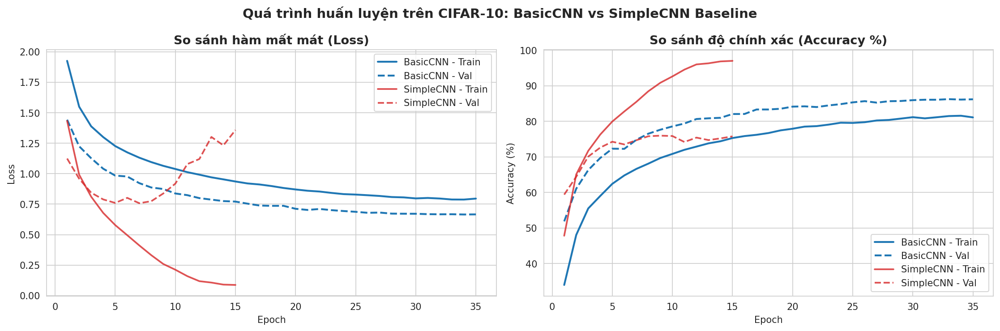
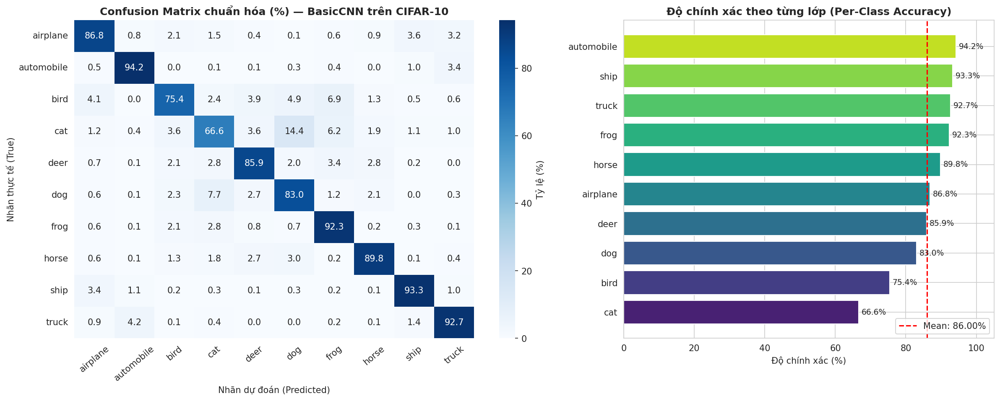
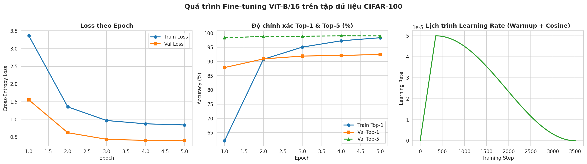
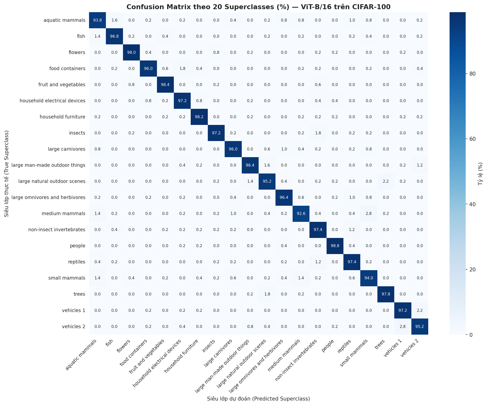
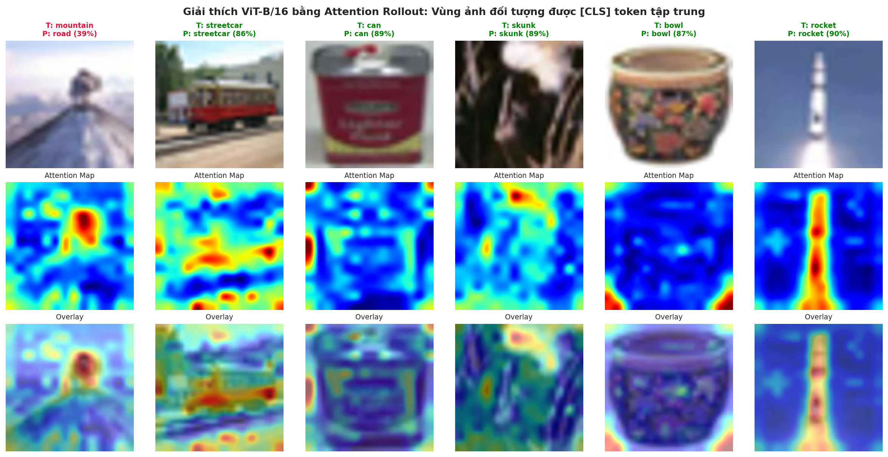

# Phase 3: Nghiên cứu về Mạng Neural trong Nhận dạng Ảnh

[](https://colab.research.google.com/github/ngdnguyen-dev/Phase-3/blob/main/notebooks/01_CNN_Basic_CIFAR10.ipynb) **Phase 3.1 — Basic CNN (CIFAR-10)**
[](https://colab.research.google.com/github/ngdnguyen-dev/Phase-3/blob/main/notebooks/02_ViT_Modern_CIFAR100.ipynb) **Phase 3.2 — Vision Transformer ViT-B/16 (CIFAR-100)**

Dự án hoàn thành đầy đủ các yêu cầu của **Phase 3 — Nghiên cứu về Mạng neural trong nhận dạng ảnh**, đã được huấn luyện và kiểm chứng trực tiếp trên **Google Colab GPU (NVIDIA Tesla T4, PyTorch 2.14 + Hugging Face `transformers`)** kèm toàn bộ output, biểu đồ trực quan và phân tích báo cáo chi tiết.

---

## Mục tiêu & Yêu cầu đề bài

- **3.1.** Cài đặt mạng **CNN cơ bản** với dữ liệu ảnh mẫu từ **CIFAR-10**.
- **3.2.** Tìm hiểu 1 trong các mạng Neural học sâu hiện đại trong bài toán nhận diện ảnh đối tượng (**CNN, ViT, Transformer, GAN, FPN**) và ứng dụng nhận diện đối tượng trên bộ dữ liệu ảnh **CIFAR-100**.
  - *Kiến trúc nghiên cứu chuyên sâu được lựa chọn:* **Vision Transformer (`ViT-B/16` — `google/vit-base-patch16-224-in21k` từ Hugging Face)**, kèm tổng quan so sánh cả 5 họ kiến trúc trong [báo cáo chi tiết](docs/Bao_Cao_Phase3_Neural_Network_CV.md).
- **Môi trường & Nộp bài:** Toàn bộ mã nguồn dưới dạng Jupyter Notebook đã thực thi trọn vẹn trên **Google Colab (Tesla T4 GPU)**, sử dụng mô hình Pre-trained & Datasets từ **Hugging Face**, đẩy lên GitHub cá nhân.

---

## Kết quả thực nghiệm chính (chạy thực tế trên Google Colab Tesla T4 GPU)

| Phần | Mô hình | Bộ dữ liệu | Số tham số | Epochs | Thời gian (T4 GPU) | Best Val Top-1 | **Test Top-1 Acc** | **Test Top-5 Acc** | **Macro F1** | **Superclass Acc (20)** |
|---|---|---|---:|---:|---:|---:|---:|---:|---:|---:|
| **3.1 (Baseline)** | `SimpleCNN` (không BN/Dropout/Aug) | CIFAR-10 (10 lớp) | 620,362 (~0.62M) | 15 | 2.66 phút | 75.96% (Ep 9) | **75.88%** | — | — | — |
| **3.1 (Chính)** | `BasicCNN` (BN + Dropout + Aug + CosineLR) | CIFAR-10 (10 lớp) | 815,082 (~0.82M) | 35 | 20.64 phút | 86.22% (Ep 33) | **86.00%** *(+10.12%)* | — | **85.87%** | — |
| **3.2 (Hiện đại)** | `ViT-B/16` (`google/vit-base-patch16-224-in21k`) | CIFAR-100 (100 lớp) | 85,875,556 (~85.9M) | 5 | 36.88 phút | 92.48% (Ep 5) | **92.22%** | **99.12%** | **92.23%** | **96.50%** |

### Điểm nhấn từ kết quả thực nghiệm
1. **Phase 3.1 (CIFAR-10 — Basic CNN từ đầu):**
   - `SimpleCNN` Baseline đạt `96.98%` Train Acc nhưng chỉ `75.76%` Val Acc ở Epoch 15 (`Val Loss = 1.3581`), chứng minh trực quan hiện tượng **Overfitting**.
   - Bổ sung `BatchNorm`, `Dropout`, Data Augmentation (`RandomCrop`, `Flip`, `ColorJitter`, `RandomErasing`), `Label Smoothing (0.05)` và `CosineAnnealingLR` giúp `BasicCNN` tăng **+10.12%** lên **86.00% Test Accuracy** (nhiều lớp đạt >92%: `automobile 94.2%`, `ship 93.3%`, `truck 92.7%`, `frog 92.3%`).
2. **Phase 3.2 (CIFAR-100 — Pre-trained Vision Transformer từ Hugging Face):**
   - Dù CIFAR-100 có **100 lớp** và số ảnh huấn luyện mỗi lớp ít hơn **10 lần** (chỉ 450 ảnh train/lớp), `ViT-B/16` pre-trained trên ImageNet-21k hội tụ cực nhanh: đạt **87.88% Val Top-1 ngay sau Epoch 1** và đạt **92.22% Test Top-1 / 99.12% Test Top-5 / 96.50% Superclass Accuracy** sau 5 epochs!
   - **55.01%** lỗi sai rơi vào các cặp lớp **cùng một Superclass** có hình thái rất gần nhau ở độ phân giải gốc $32 \times 32$ (toàn bộ Top-10 cặp dễ nhầm nhất đều cùng siêu lớp, ví dụ `oak_tree ↔ maple_tree`, `seal → otter`, `bowl → plate`, `girl → baby`, `man ↔ boy`).
   - Trực quan hóa **Attention Rollout** xác nhận `[CLS]` token của ViT tập trung chính xác vào đối tượng trung tâm thay vì nhiễu nền.

---

## Biểu đồ nổi bật từ thực nghiệm

### Phase 3.1 — Basic CNN trên CIFAR-10



### Phase 3.2 — Vision Transformer (ViT-B/16) trên CIFAR-100




---

## Cấu trúc thư mục dự án

```text
.
├── README.md                                       # Tổng quan dự án, kết quả thực chạy & hướng dẫn
├── requirements.txt                                # Danh sách thư viện Python
├── .gitignore                                      # Loại trừ dataset, checkpoint nặng & cache
├── notebooks/
│   ├── 01_CNN_Basic_CIFAR10.ipynb                  # Phase 3.1 (đã chạy đầy đủ kèm output & biểu đồ)
│   └── 02_ViT_Modern_CIFAR100.ipynb                # Phase 3.2 (đã chạy đầy đủ kèm output & biểu đồ)
└── docs/
    ├── Bao_Cao_Phase3_Neural_Network_CV.md         # Báo cáo lý thuyết & phân tích thực nghiệm đầy đủ
    └── images/
        ├── cnn_cifar10/                            # 7 biểu đồ PNG + metrics_summary.json (Phase 3.1)
        └── vit_cifar100/                           # 7 biểu đồ PNG + metrics_summary.json (Phase 3.2)
```

---

## Hướng dẫn chạy lại trên Google Colab hoặc Kaggle

1. **Google Colab:** Bấm trực tiếp vào 2 nút **Open in Colab** ở đầu trang này → chọn `Runtime → Change runtime type → T4 GPU` → bấm **Runtime → Run all**.
2. **Kaggle:** Import từng file `.ipynb` trong thư mục `notebooks/` → bật **Accelerator: GPU T4 / P100** và **Internet: On** → bấm **Run All**.

> *Lưu ý:* Cả 2 notebook tải CIFAR-10 / CIFAR-100 qua **Hugging Face Datasets** (`uoft-cs/cifar10`, `uoft-cs/cifar100`, tự động fallback về `torchvision` nếu cần) giúp tải toàn bộ 60,000 ảnh chỉ trong vài giây thay vì bị bóp băng thông từ máy chủ Toronto.

---

## Báo cáo chuyên sâu

Xem đầy đủ cơ sở lý thuyết, công thức toán học, so sánh 5 kiến trúc học sâu hiện đại (Modern CNN, ViT, Transformer, GAN, FPN), phân tích từng biểu đồ thực nghiệm và tài liệu tham khảo tại:
- [`docs/Bao_Cao_Phase3_Neural_Network_CV.md`](docs/Bao_Cao_Phase3_Neural_Network_CV.md)
