# BÁO CÁO PHASE 3: NGHIÊN CỨU VỀ MẠNG NEURAL TRONG NHẬN DẠNG ẢNH

- **Chủ đề:** Cài đặt mạng CNN cơ bản trên CIFAR-10 (Phase 3.1) & Nghiên cứu kiến trúc học sâu hiện đại Vision Transformer (ViT) ứng dụng trên CIFAR-100 (Phase 3.2).
- **Môi trường thực nghiệm:** Google Colab — **NVIDIA Tesla T4 (15.64 GB VRAM)**, PyTorch `2.14.1+cu130`, Torchvision `0.29.1`, Hugging Face `transformers` & `datasets`.
- **Notebook đã thực thi (đầy đủ output & biểu đồ):**
  - Phase 3.1: [`../notebooks/01_CNN_Basic_CIFAR10.ipynb`](../notebooks/01_CNN_Basic_CIFAR10.ipynb) — [Mở trên Google Colab](https://colab.research.google.com/github/ngdnguyen-dev/Phase-3/blob/main/notebooks/01_CNN_Basic_CIFAR10.ipynb)
  - Phase 3.2: [`../notebooks/02_ViT_Modern_CIFAR100.ipynb`](../notebooks/02_ViT_Modern_CIFAR100.ipynb) — [Mở trên Google Colab](https://colab.research.google.com/github/ngdnguyen-dev/Phase-3/blob/main/notebooks/02_ViT_Modern_CIFAR100.ipynb)

---

## Mục lục
1. [Tổng quan bài toán & Bộ dữ liệu CIFAR-10 / CIFAR-100](#1-tổng-quan-bài-toán--bộ-dữ-liệu-cifar-10--cifar-100)
2. [Phase 3.1: Cài đặt mạng CNN cơ bản với dữ liệu CIFAR-10](#2-phase-31-cài-đặt-mạng-cnn-cơ-bản-với-dữ-liệu-cifar-10)
3. [Phase 3.2: Nghiên cứu các kiến trúc Neural hiện đại & Chuyên sâu Vision Transformer (ViT)](#3-phase-32-nghiên-cứu-các-kiến-trúc-neural-hiện-đại--chuyên-sâu-vision-transformer-vit)
4. [Ứng dụng Pre-trained ViT trên tập dữ liệu CIFAR-100 & Kết quả thực nghiệm](#4-ứng-dụng-pre-trained-vit-trên-tập-dữ-liệu-cifar-100--kết-quả-thực-nghiệm)
5. [Bảng tổng hợp đối chiếu Phase 3.1 vs Phase 3.2](#5-bảng-tổng-hợp-đối-chiếu-phase-31-vs-phase-32)
6. [Kết luận, Hạn chế & Hướng phát triển](#6-kết-luận-hạn-chế--hướng-phát-triển)
7. [Tài liệu tham khảo](#7-tài-liệu-tham-khảo)

---

## 1. Tổng quan bài toán & Bộ dữ liệu CIFAR-10 / CIFAR-100

Bài toán **phân loại ảnh (Image Classification)** ánh xạ một ảnh màu RGB đầu vào $\mathbf{x} \in \mathbb{R}^{H \times W \times 3}$ sang nhãn lớp $y \in \{1, \dots, C\}$ bằng cách cực tiểu hóa hàm mất mát Cross-Entropy:

$$\mathcal{L}_{\text{CE}} = -\frac{1}{B} \sum_{i=1}^{B} \log P(y_i \mid \mathbf{x}_i; \theta)$$

Hai bộ dữ liệu kinh điển (*Krizhevsky, 2009*) dùng trong Phase 3 có sự khác biệt lớn về độ khó:

| Đặc trưng | CIFAR-10 (Phase 3.1) | CIFAR-100 (Phase 3.2) |
|---|---|---|
| Kích thước ảnh gốc | $32 \times 32 \times 3$ (RGB) | $32 \times 32 \times 3$ (RGB) |
| Tổng số ảnh | 60,000 ảnh | 60,000 ảnh |
| Số lượng lớp (*Fine Classes*) | **10 lớp** | **100 lớp** (thuộc **20 Superclasses**) |
| Chia Stratified Split | 45,000 Train / 5,000 Val / 10,000 Test | 45,000 Train / 5,000 Val / 10,000 Test |
| Số ảnh Train mỗi lớp | **4,500 ảnh/lớp** | **450 ảnh/lớp** (giảm 10×) |
| Thách thức chính | Nhầm lẫn cục bộ ở nhóm động vật (`cat`–`dog`, `bird`–`frog`) | Rất ít mẫu/lớp; nhiều lớp cùng siêu lớp cực giống nhau ở $32 \times 32$ (`oak_tree`–`maple_tree`, `girl`–`boy`, `seal`–`otter`) |

---

## 2. Phase 3.1: Cài đặt mạng CNN cơ bản với dữ liệu CIFAR-10

### 2.1. Cơ sở lý thuyết mạng nơ-ron tích chập (CNN)
Mạng CNN tận dụng 2 **giả định quy nạp (*inductive biases*)** cốt lõi của ảnh:
1. **Tính cục bộ (Locality):** Bộ lọc nhỏ $3 \times 3$ học các đặc trưng từ cấp thấp (cạnh, màu sắc) đến cấp cao (kết cấu, bộ phận đối tượng).
2. **Chia sẻ trọng số & Bất biến dịch chuyển (Weight Sharing & Translation Equivariance):** Trượt cùng một kernel trên toàn ảnh giúp giảm mạnh số tham số.

Kích thước đầu ra của tầng `Conv2d` với đầu vào $(H_{\text{in}}, W_{\text{in}})$, kernel $K$, padding $P$ và stride $S$:

$$H_{\text{out}} = \left\lfloor \frac{H_{\text{in}} + 2P - K}{S} \right\rfloor + 1$$

### 2.2. Kiến trúc thực nghiệm đối chứng (`SimpleCNN` vs `BasicCNN`)

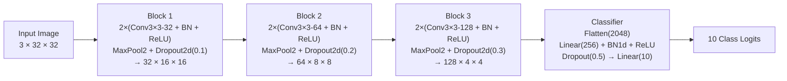

- **Thực nghiệm A — `SimpleCNN` (Baseline, 620,362 tham số):** 3 lớp `Conv3×3 → ReLU → MaxPool` đơn lẻ, không `BatchNorm`, không `Dropout`, không Data Augmentation (15 epochs, Adam `lr=1e-3`).
- **Thực nghiệm B — `BasicCNN` (Chính, 815,082 tham số):** 3 khối tích chập VGG-style (`2×[Conv3×3 + BatchNorm2d + ReLU] + MaxPool2d + Dropout2d`), khởi tạo Kaiming, Data Augmentation (`RandomCrop(32, padding=4, reflect)`, `RandomHorizontalFlip(0.5)`, `ColorJitter(0.15)`, `RandomErasing(0.2)`), `AdamW(lr=1e-3, weight_decay=5e-4)`, `Label Smoothing (0.05)` và `CosineAnnealingLR` (35 epochs, FP16 AMP).

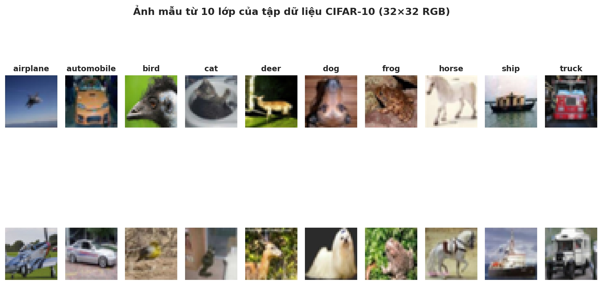
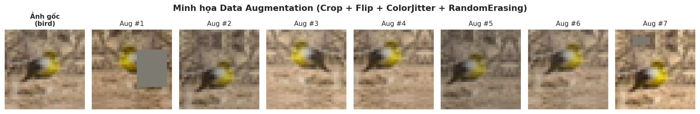

### 2.3. Kết quả thực nghiệm Phase 3.1 (trên Tesla T4 GPU)

| Mô hình | Số tham số | Epochs | Thời gian | Best Val Acc | Test Loss | **Test Accuracy** | **Macro F1** |
|---|---:|---:|---:|---:|---:|---:|---:|
| `SimpleCNN` (Baseline) | 620,362 | 15 | 159.8s (2.66 phút) | 75.96% (Epoch 9) | 0.8438 | **75.88%** | — |
| **`BasicCNN` (Chính)** | **815,082** | **35** | **1,238.6s (20.64 phút)** | **86.22% (Epoch 33)** | **0.4264** | **86.00% (+10.12%)** | **85.87%** |

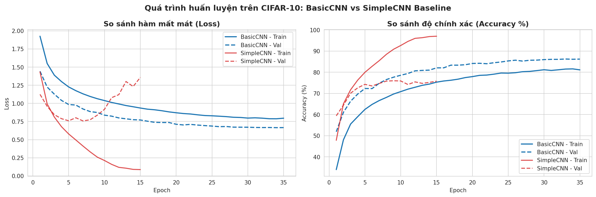

- **Phân tích Overfitting:** Ở Epoch 15, `SimpleCNN` đạt **96.98% Train Acc** (`Train Loss = 0.0875`) nhưng chỉ **75.76% Val Acc** (`Val Loss = 1.3581` tăng ngược trở lại sau Epoch 5) — minh họa kinh điển của hiện tượng học thuộc lòng dữ liệu huấn luyện. Ngược lại, `BasicCNN` giữ đường cong Validation bám sát Train ổn định suốt 35 epochs và cải thiện **+10.12%** Test Accuracy.

#### Hiệu năng từng lớp & Ma trận nhầm lẫn (10,000 ảnh Test)

| Lớp | `automobile` | `ship` | `truck` | `frog` | `horse` | `airplane` | `deer` | `dog` | `bird` | `cat` |
|---|---:|---:|---:|---:|---:|---:|---:|---:|---:|---:|
| **Accuracy (%)** | **94.2%** | **93.3%** | **92.7%** | **92.3%** | **89.8%** | 86.8% | 85.9% | 83.0% | 75.4% | **66.6%** |

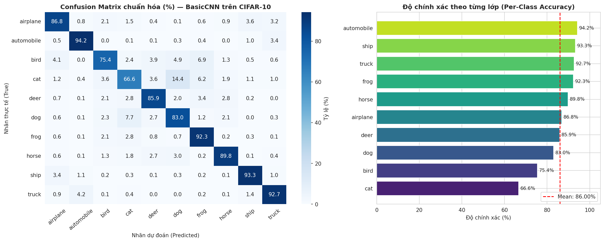

- **Top-5 cặp dễ nhầm nhất:** `cat → dog` (144 ảnh), `dog → cat` (77 ảnh), `bird → frog` (69 ảnh), `cat → frog` (62 ảnh), `bird → dog` (49 ảnh).

#### Giải thích nội tại CNN: Bộ lọc Conv1, Feature Maps & Phân tích lỗi

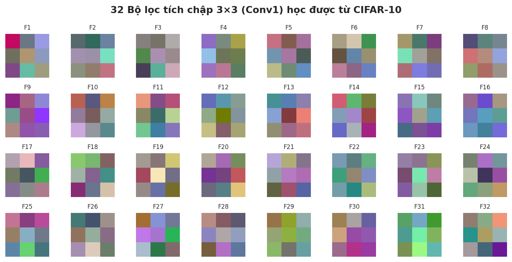
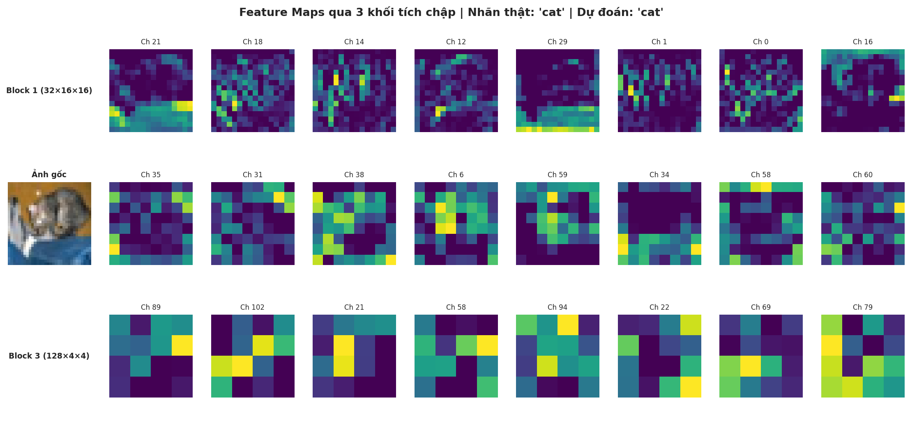
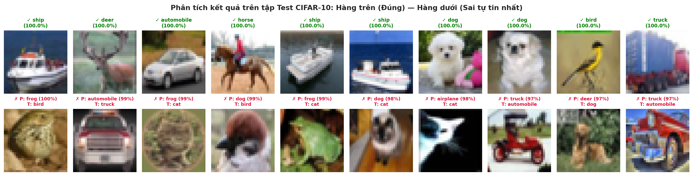

---

## 3. Phase 3.2: Nghiên cứu các kiến trúc Neural hiện đại & Chuyên sâu Vision Transformer (ViT)

### 3.1. Tổng quan so sánh 5 họ kiến trúc học sâu hiện đại trong đề bài

| Kiến trúc | Đại diện tiêu biểu | Cơ chế cốt lõi | Bài toán chính | Ưu điểm | Hạn chế |
|---|---|---|---|---|---|
| **Modern CNN** | ResNet (2015), EfficientNet (2019), ConvNeXt (2022) | Residual Skip Connection ($y = F(x)+x$), Depthwise Separable Conv, kernel lớn $7 \times 7$, LayerNorm | Phân loại ảnh, Backbone cho Detection/Segmentation | Giả định cục bộ mạnh, huấn luyện ổn định, suy luận nhanh trên thiết bị biên | Tương tác toàn cục mở rộng chậm theo độ sâu mạng |
| **ViT (Vision Transformer)** | ViT-B/16 (2021), DeiT (2021), DINOv2 (2023) | Chia ảnh thành chuỗi patches $16 \times 16$ và xử lý bằng **Transformer Encoder thuần túy** | Phân loại ảnh, Foundation Backbone, Multimodal (CLIP/VLM) | **Ngữ cảnh toàn cục ngay từ tầng 1**, khả năng scaling & Transfer Learning vượt trội | Cần pre-training quy mô lớn (ImageNet-21k); độ phức tạp attention $O(N^2)$ |
| **Transformer (Vision)** | DETR (2020), Swin Transformer (2021), Mask2Former | Shifted Window Self-Attention phân cấp hoặc Encoder–Decoder với *Object Queries* | Phát hiện đối tượng (*Object Detection*), Phân vùng (*Segmentation*) | End-to-end (DETR bỏ Anchor & NMS), Swin giảm độ phức tạp còn tuyến tính $O(N)$ | Thiết kế phức tạp hơn, nhạy siêu tham số khi train từ đầu |
| **GAN** | DCGAN, StyleGAN2/3, CycleGAN | Huấn luyện đối kháng minmax giữa **Generator $G$** và **Discriminator $D$** | **Sinh ảnh (Image Generation)**, tăng cường dữ liệu, siêu phân giải | Tạo ảnh sắc nét, sinh mẫu nhanh trong 1 lượt forward | Dễ mất ổn định (*mode collapse*), không phải bộ phân loại đối tượng trực tiếp |
| **FPN (Feature Pyramid Network)** | FPN (2017), PANet, BiFPN | Kết hợp đường dẫn *bottom-up* và *top-down* + kết nối ngang (*lateral*) tạo tháp đặc trưng đa tỷ lệ | Phát hiện đối tượng nhiều kích thước (*Multi-scale Detection*) | Phát hiện tốt cả vật thể nhỏ lẫn lớn | Là mô-đun *Neck* gắn sau backbone, không phải mô hình phân loại độc lập |

### 3.2. Phân tích chuyên sâu kiến trúc Vision Transformer (ViT-B/16)

**Vision Transformer (ViT)** (*Dosovitskiy et al., ICLR 2021*) loại bỏ hoàn toàn phép tích chập cục bộ và coi ảnh như một chuỗi các mảnh (*image patches*):

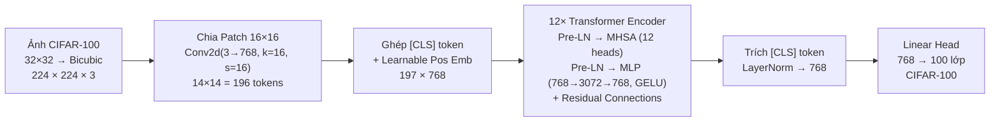

1. **Patch & Position Embedding:** Ảnh $224 \times 224 \times 3$ chia thành $N = 14 \times 14 = 196$ patches $16 \times 16$:
   $$\mathbf{z}_0 = \left[\mathbf{x}_{\text{class}};\; \mathbf{x}_p^1 \mathbf{E};\; \dots;\; \mathbf{x}_p^{196} \mathbf{E}\right] + \mathbf{E}_{\text{pos}} \in \mathbb{R}^{197 \times 768}$$
2. **Multi-Head Self-Attention (12 heads, $d_k = 64$):**
   $$\text{Attention}(Q, K, V) = \text{softmax}\!\left(\frac{Q K^\top}{\sqrt{d_k}}\right) V$$
3. **Transformer Encoder ($L = 12$ tầng, Pre-LayerNorm):**
   $$\mathbf{z}'_\ell = \text{MSA}(\text{LN}(\mathbf{z}_{\ell-1})) + \mathbf{z}_{\ell-1}, \qquad \mathbf{z}_\ell = \text{MLP}(\text{LN}(\mathbf{z}'_\ell)) + \mathbf{z}'_\ell$$
4. **Attention Rollout (*Abnar & Zuidema, 2020*):** Kết hợp trọng số chú ý qua tất cả 12 tầng kèm kết nối residual $\hat{A}^{(\ell)} = \text{row\_norm}(0.5\,\bar{A}^{(\ell)} + 0.5\,I)$ và nhân tích lũy $R = \hat{A}^{(12)} \cdots \hat{A}^{(1)}$ để chiếu ngược mức độ chú ý của `[CLS]` token lên lưới $14 \times 14$ vùng ảnh.

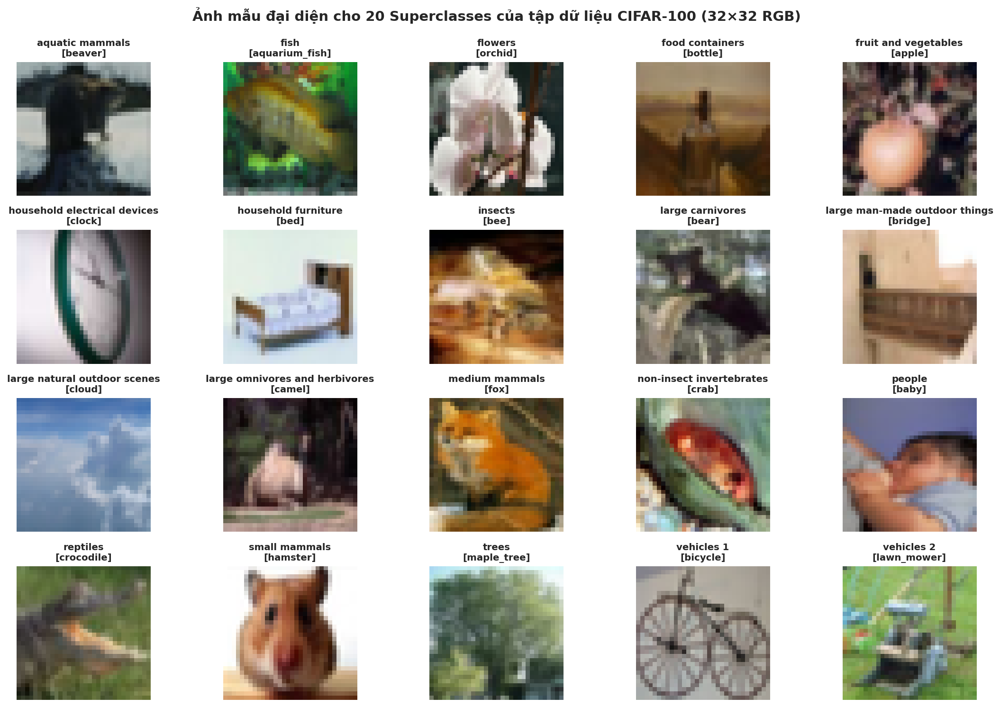
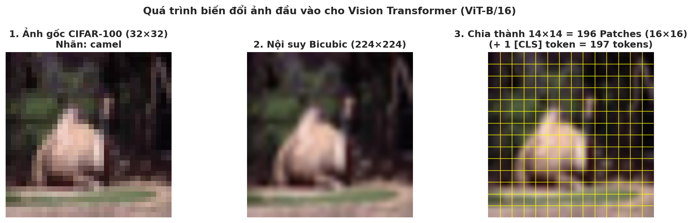

---

## 4. Ứng dụng Pre-trained ViT trên tập dữ liệu CIFAR-100 & Kết quả thực nghiệm

### 4.1. Thiết lập Fine-tuning từ Hugging Face
- **Mô hình Pre-trained:** [`google/vit-base-patch16-224-in21k`](https://huggingface.co/google/vit-base-patch16-224-in21k) (**85,875,556 tham số**, pre-trained trên 14 triệu ảnh ImageNet-21k), thay đầu ra thành `Linear(768 → 100)` (76,900 tham số mới) gắn đầy đủ `id2label` / `label2id`.
- **Pipeline tối ưu:** `RandomHorizontalFlip(0.5)` + `ColorJitter(0.15)` thực hiện trên ảnh gốc $32 \times 32$ trước khi `RandomResizedCrop(224, scale=(0.8, 1.0), BICUBIC)` (tăng tốc DataLoader gấp 49× trên CPU, giữ GPU T4 hoạt động ổn định **99%**).
- **Siêu tham số:** `Epochs = 5`, `Batch size = 64`, `AdamW` (`lr = 5e-5`, `weight_decay = 0.01`, miễn weight decay cho `bias`/`LayerNorm`/`position_embeddings`/`cls_token`), `get_cosine_schedule_with_warmup` (10% warmup), `Label Smoothing = 0.10`, `Gradient Clipping = 1.0`, Mixed Precision **AMP FP16**.

### 4.2. Diễn biến huấn luyện theo 5 Epochs (Tesla T4 GPU — tổng 36.88 phút)

| Epoch | Train Loss | Train Top-1 | Val Loss | **Val Top-1** | **Val Top-5** | Thời gian |
|---:|---:|---:|---:|---:|---:|---:|
| 1/5 | 3.3634 | 62.14% | 1.5499 | 87.88% | 98.34% | 437.1s |
| 2/5 | 1.3528 | 90.79% | 0.6225 | 90.92% | 98.82% | 443.1s |
| 3/5 | 0.9670 | 95.07% | 0.4363 | 91.92% | 98.88% | 442.8s |
| 4/5 | 0.8742 | 97.29% | 0.4042 | 92.14% | 99.04% | 445.2s |
| **5/5** | **0.8418** | **98.37%** | **0.3939** | **92.48% ★** | **99.02%** | **444.5s** |

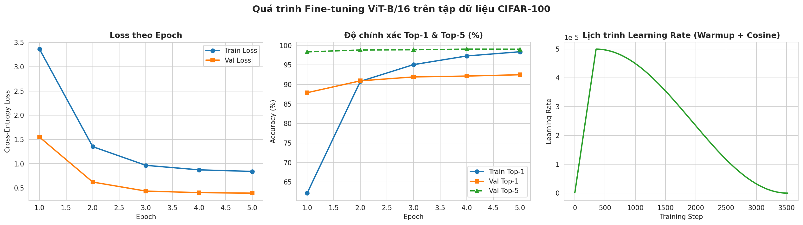

### 4.3. Đánh giá chính thức trên tập Test CIFAR-100 (10,000 ảnh)

| Chỉ số đánh giá | Giá trị thực đo |
|---|---:|
| **Test Loss** | `0.4038` |
| **Test Top-1 Accuracy (100 Fine Classes)** | **`92.22%`** |
| **Test Top-5 Accuracy (100 Fine Classes)** | **`99.12%`** |
| **Macro Precision** | `92.30%` |
| **Macro Recall** | `92.22%` |
| **Macro F1-score** | **`92.23%`** |
| **Superclass Accuracy (20 nhóm lớn)** | **`96.50%`** |
| **Tỷ lệ lỗi nhầm trong cùng Superclass** | **`55.01%`** (428 / 778 ảnh sai) |

#### Phân tích sâu theo lớp & Superclass

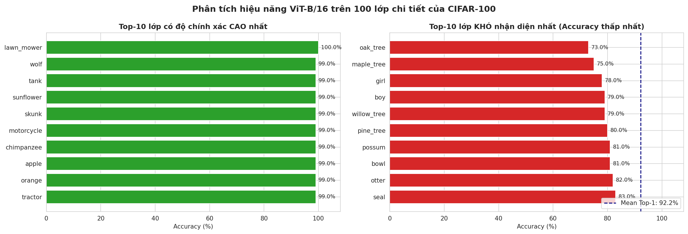
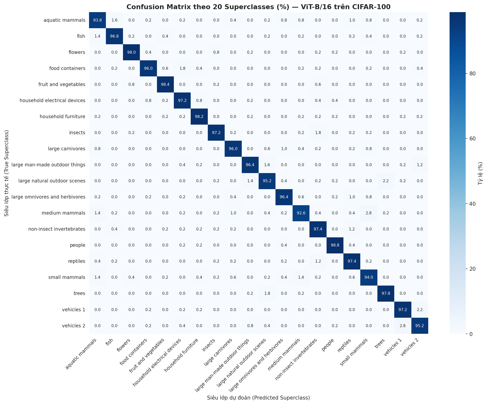

- **Top-10 lớp tốt nhất:** `lawn_mower` (**100.0%**), cùng 9 lớp đạt **99.0%** (`wolf`, `tank`, `sunflower`, `skunk`, `motorcycle`, `chimpanzee`, `apple`, `orange`, `tractor`).
- **Top-10 lớp khó nhất:** `oak_tree` (73.0%), `maple_tree` (75.0%), `girl` (78.0%), `boy` (79.0%), `willow_tree` (79.0%), `pine_tree` (80.0%), `possum` (81.0%), `bowl` (81.0%), `otter` (82.0%), `seal` (83.0%).
- **Top-10 cặp lớp nhầm lẫn nhiều nhất — 10/10 cặp đều thuộc CÙNG Superclass:**

| Hạng | Nhãn thật | Dự đoán nhầm | Số ảnh sai (/100) | Siêu lớp (Superclass) |
|---:|---|---|---:|---|
| 1 | `oak_tree` | `maple_tree` | 21 | `trees` |
| 2 | `maple_tree` | `oak_tree` | 19 | `trees` |
| 3 | `seal` | `otter` | 10 | `aquatic_mammals` |
| 4 | `bowl` | `plate` | 9 | `food_containers` |
| 5 | `girl` | `baby` | 9 | `people` |
| 6 | `man` | `boy` | 9 | `people` |
| 7 | `pine_tree` | `oak_tree` | 9 | `trees` |
| 8 | `willow_tree` | `maple_tree` | 9 | `trees` |
| 9 | `baby` | `boy` | 8 | `people` |
| 10 | `boy` | `man` | 8 | `people` |

> Nhận xét: Dù mất độ nét nghiêm trọng ở ảnh gốc $32 \times 32$ (ví dụ phân biệt lá cây sồi `oak_tree` với cây phong `maple_tree` hay gương mặt `boy`/`girl`/`baby`), **Top-5 Accuracy đạt 99.12%** cho thấy nhãn đúng gần như luôn nằm ngay trong Top-5 dự đoán của ViT!

#### Phân tích dự đoán & Giải thích mô hình bằng Attention Rollout

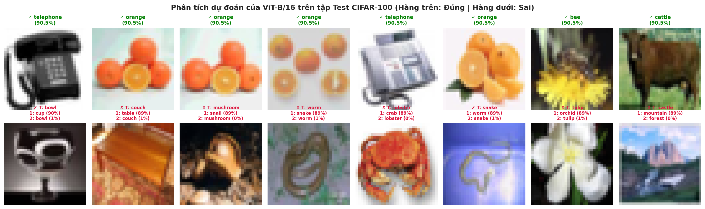
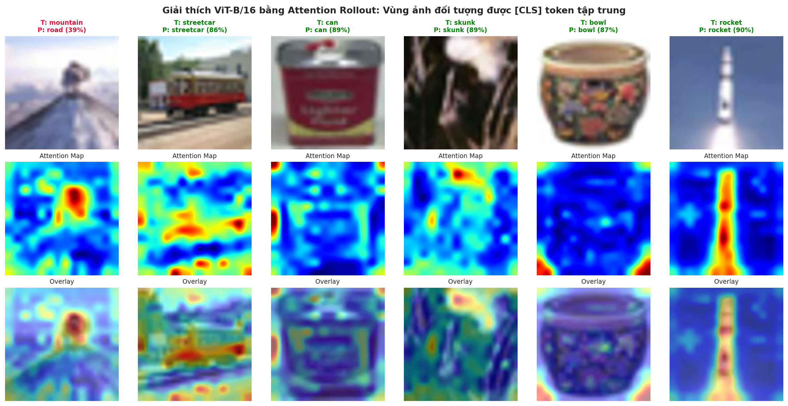

Bản đồ **Attention Rollout** minh chứng rõ ràng cơ chế Self-Attention toàn cục của ViT: trọng số chú ý từ `[CLS]` token tập trung mạnh vào chính đối tượng mục tiêu và bỏ qua nền xung quanh.

---

## 5. Bảng tổng hợp đối chiếu Phase 3.1 vs Phase 3.2

| Tiêu chí | Phase 3.1 — `SimpleCNN` (Baseline) | Phase 3.1 — `BasicCNN` (Chính) | Phase 3.2 — `ViT-B/16` (HF Pre-trained) |
|---|---|---|---|
| Bộ dữ liệu | CIFAR-10 (10 lớp) | CIFAR-10 (10 lớp) | CIFAR-100 (100 lớp / 20 superclasses) |
| Chiến lược huấn luyện | Từ đầu (*from scratch*) | Từ đầu + BN + Dropout + Augmentation | **Fine-tuning từ ImageNet-21k** |
| Số lượng tham số | 620,362 (~0.62M) | 815,082 (~0.82M) | 85,875,556 (~85.9M) |
| Kích thước đầu vào | $32 \times 32$ | $32 \times 32$ | $224 \times 224$ ($14 \times 14$ patches) |
| Số Epochs | 15 | 35 | 5 |
| Thời gian huấn luyện (Tesla T4) | 2.66 phút (159.8s) | 20.64 phút (1,238.6s) | 36.88 phút |
| Best Validation Top-1 | 75.96% (Epoch 9) | 86.22% (Epoch 33) | **92.48% (Epoch 5)** |
| **Test Top-1 Accuracy** | **75.88%** | **86.00%** | **92.22%** |
| **Test Top-5 Accuracy** | — | — | **99.12%** |
| **Macro F1-score** | — | **85.87%** | **92.23%** |
| **Superclass Accuracy (20)** | — | — | **96.50%** |

---

## 6. Kết luận, Hạn chế & Hướng phát triển

### Kết luận chính
1. **Hiệu quả của kỹ thuật chuẩn hóa & điều chuẩn trong CNN (Phase 3.1):** Bổ sung `BatchNorm`, `Dropout`, Data Augmentation, `Label Smoothing` và `CosineAnnealingLR` giúp giảm mạnh overfitting so với `SimpleCNN` thuần túy và nâng Test Accuracy trên CIFAR-10 từ **75.88% → 86.00%** (**+10.12%**) chỉ với ~0.82M tham số.
2. **Sức mạnh vượt trội của Vision Transformer & Transfer Learning (Phase 3.2):** Trên bộ dữ liệu khó gấp nhiều lần (**CIFAR-100**, 100 lớp, chỉ 450 ảnh train/lớp), Fine-tuning mô hình `google/vit-base-patch16-224-in21k` từ Hugging Face đạt **92.22% Top-1**, **99.12% Top-5** và **96.50% Superclass Accuracy** chỉ sau 5 epochs — đồng thời giải thích trực quan được quyết định qua **Attention Rollout**.

### Hạn chế & Hướng phát triển
- **Tài nguyên tính toán của ViT:** `ViT-B/16` lớn hơn ~105× về số tham số so với `BasicCNN` và đòi hỏi phóng ảnh $224 \times 224$. Trong triển khai thực tế có thể kết hợp **Knowledge Distillation (DeiT)**, **Quantization (INT8/FP16)** hoặc các backbone hiệu quả như **Swin Transformer / ConvNeXt-Tiny**.
- **Cải thiện độ chính xác lớp mịn trên CIFAR-100:** Áp dụng thêm **Mixup / CutMix**, **RandAugment**, **EMA (Exponential Moving Average)** và **Test-Time Augmentation (TTA)**.
- **Mở rộng sang Object Detection / Segmentation:** Kết hợp backbone hiện đại với **FPN** hoặc **DETR** trên bộ dữ liệu COCO / Pascal VOC.

---

## 7. Tài liệu tham khảo

1. Krizhevsky, A. (2009). *Learning Multiple Layers of Features from Tiny Images* (CIFAR-10 & CIFAR-100). University of Toronto.
2. Simonyan, K., & Zisserman, A. (2015). *Very Deep Convolutional Networks for Large-Scale Image Recognition* (VGG). ICLR 2015.
3. He, K., Zhang, X., Ren, S., & Sun, J. (2016). *Deep Residual Learning for Image Recognition* (ResNet). CVPR 2016.
4. Goodfellow, I., et al. (2014). *Generative Adversarial Nets* (GAN). NeurIPS 2014.
5. Lin, T.-Y., et al. (2017). *Feature Pyramid Networks for Object Detection* (FPN). CVPR 2017.
6. Vaswani, A., et al. (2017). *Attention Is All You Need*. NeurIPS 2017.
7. Dosovitskiy, A., et al. (2021). *An Image is Worth 16x16 Words: Transformers for Image Recognition at Scale* (ViT). ICLR 2021.
8. Abnar, S., & Zuidema, W. (2020). *Quantifying Attention Flow in Transformers* (Attention Rollout). ACL 2020.
9. Hugging Face Model Card — `google/vit-base-patch16-224-in21k`: https://huggingface.co/google/vit-base-patch16-224-in21k
